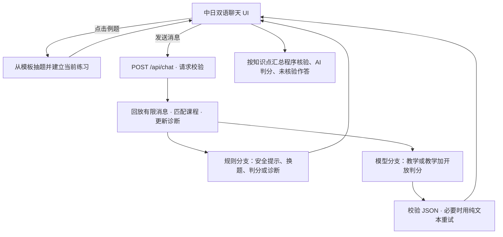

# 技术架构

题库按钮在浏览器生成题目。聊天中的「再来一个」由服务端识别并生成新练习。前端将原练习移入可回看的记录，新答复携带新练习。后端以当前题与最新追问区分判分对象，并按有界的对话历史重算诊断。超出历史窗口的证据可能丢失。

规则可判定时，服务端直接返回。需要讲解时，真实模式向模型发送课程上下文、当前练习及最近最多 9 条经过关键词过滤的消息。开放判分在同一次模型请求内完成。模型判分与程序核验分别记录，模型判分不会直接更新误区状态。学习总结由前端聚合，朗读由浏览器处理。

| 源码 | 职责 |
| --- | --- |
| `src/app/page.tsx`、`chat-copy.ts`、`globals.css` | 双语聊天、随机例题、换题、朗读、页面样式 |
| `src/app/learning-summary.tsx` | 学习总结、评价、不足点和推荐练习 |
| `src/app/api/chat/route.ts`、`src/lib/chat-contract.ts` | HTTP 接口、大小限制和结构校验 |
| `src/lib/curriculum.ts`、`chinese-input.ts`、`src/data/curriculum.json` | 知识点和语言归一化、匹配规则 |
| `src/lib/practice.ts`、`practice-feedback.ts` | 双语模板抽题、可确定的答案核验 |
| `src/lib/diagnosis.ts`、`src/data/misconceptions.json` | 「割合」误区状态机和双语反馈 |
| `src/lib/tutor.ts`、`tutor-prompt.ts` | 分流、模型请求、提示词和降级 |

流程图可直接插入 Word。 [中文版 PNG](poc-llm-flow-zh.png) · [日语版 PNG](poc-llm-flow-ja.png)
